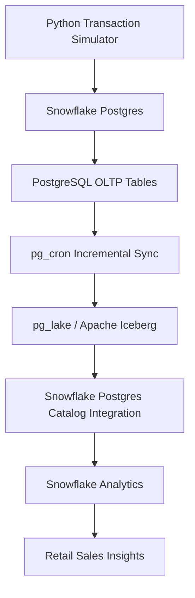

# Snowflake Postgres + pg_lake: Apache Iceberg Lakehouse

An end-to-end retail analytics lakehouse built with Snowflake Postgres, PostgreSQL, pg_lake, Apache Iceberg, pg_cron, Python, and Snowflake.

This project demonstrates how operational PostgreSQL transactions can be incrementally synchronized into Apache Iceberg tables and analyzed directly in Snowflake.

## Architecture



## Technology Stack

| Technology | Purpose |
|---|---|
| Snowflake Postgres | Managed PostgreSQL instance |
| PostgreSQL | Operational transaction processing |
| pg_lake | Apache Iceberg table management |
| Apache Iceberg | Open analytical table format |
| pg_cron | Scheduled incremental synchronization |
| Python | Transaction data simulation |
| psycopg2 | PostgreSQL connectivity |
| Snowflake | SQL analytics over Iceberg tables |
| AWS S3 | Object storage infrastructure |

## Project Structure

```text
.
├── README.md
├── .gitignore
├── simulate_transactions.py
├── sql/
│   ├── postgres/
│   │   ├── 01_create_oltp_tables.sql
│   │   ├── 02_seed_reference_data.sql
│   │   ├── 03_create_iceberg_tables.sql
│   │   ├── 04_seed_iceberg_data.sql
│   │   └── 05_incremental_sync.sql
│   └── snowflake/
│       ├── 01_catalog_integration.sql
│       ├── 02_create_iceberg_tables.sql
│       └── 03_analytics.sql
└── docs/
```

## Data Pipeline

### 1. Operational Data

Five PostgreSQL OLTP tables:

- stores
- products
- customers
- transactions
- transaction_items

### 2. Apache Iceberg Layer

Five Iceberg tables managed through pg_lake:

- iceberg_stores
- iceberg_products
- iceberg_customers
- iceberg_transactions
- iceberg_transaction_items

The Iceberg tables in this implementation used storage managed by the Snowflake Postgres environment.

### 3. Incremental Synchronization

Two pg_cron jobs periodically synchronize new operational records:

- sync_txn_headers
- sync_txn_items

The jobs are scheduled to run every minute and use the synced_at column to identify pending records.

### 4. Snowflake Catalog Integration

Snowflake accesses the Iceberg tables through the catalog integration:

`PG_LAKE_POSTGRES_CATALOG`

The analytical database is:

`PG_LAKE_ANALYTICS`

## Python Transaction Simulator

The Python simulator generates synthetic retail transactions and inserts them into PostgreSQL.

Example:

```bash
python simulate_transactions.py --transactions 100 --batch-size 50
```

The script prompts for the PostgreSQL password rather than storing it in source code.

## Verified Results

The pipeline was tested using synthetic retail data.

| Metric | Result |
|---|---:|
| Stores | 5 |
| Products | 15 |
| Customers | 10 |
| Generated transactions | 100 |
| Iceberg transaction records | 100 |
| Iceberg transaction item records | 297 |
| Total revenue | 26,295.94 |
| Units sold | 606 |

### Store Performance

Highest-revenue store:

**Harbor Point — 7,197.48**

### Category Performance

Highest-revenue category:

**Electronics — 11,378.30**

### Product Performance

Highest-revenue product:

**Running Shoes — 5,849.55**

## SQL Analytics

The project includes three analytical queries:

1. Store sales performance
2. Product category performance
3. Top 10 products by revenue

See:

`sql/snowflake/03_analytics.sql`

## Reproduction Guide

1. Provision a Snowflake Postgres instance.
2. Enable the pg_lake extension.
3. Create and seed the PostgreSQL OLTP tables.
4. Create Apache Iceberg tables using pg_lake.
5. Populate the Iceberg reference tables.
6. Configure incremental synchronization with pg_cron.
7. Configure the Snowflake Postgres catalog integration.
8. Register the Iceberg tables in Snowflake.
9. Configure PostgreSQL connectivity for the Python simulator.
10. Generate synthetic transactions and run the analytical queries.

The scripts are documented examples from the completed lab, not a fully automated deployment. Some SQL definitions may require adjustment for the target environment.

## Security Notes

- Do not commit PostgreSQL passwords or AWS credentials.
- Keep local `.env` files out of version control.
- Restrict PostgreSQL network access to trusted clients.
- Review cloud resource costs and remove unused resources after experimentation.

## Learning Outcomes

- Building a hybrid OLTP and analytical lakehouse architecture
- Managing Apache Iceberg tables through PostgreSQL
- Implementing scheduled incremental data synchronization
- Connecting Snowflake to an external Iceberg catalog
- Querying Iceberg data with Snowflake SQL
- Generating synthetic transaction workloads with Python

## Reference

[Snowflake Developer Guide — Build a Lakehouse with Snowflake Postgres and pg_lake](https://www.snowflake.com/en/developers/guides/build-a-lakehouse-with-snowflake-postgres-and-pg-lake/)

## Disclaimer

This is an educational portfolio project. All retail transactions and analytical results are based on synthetic data.
